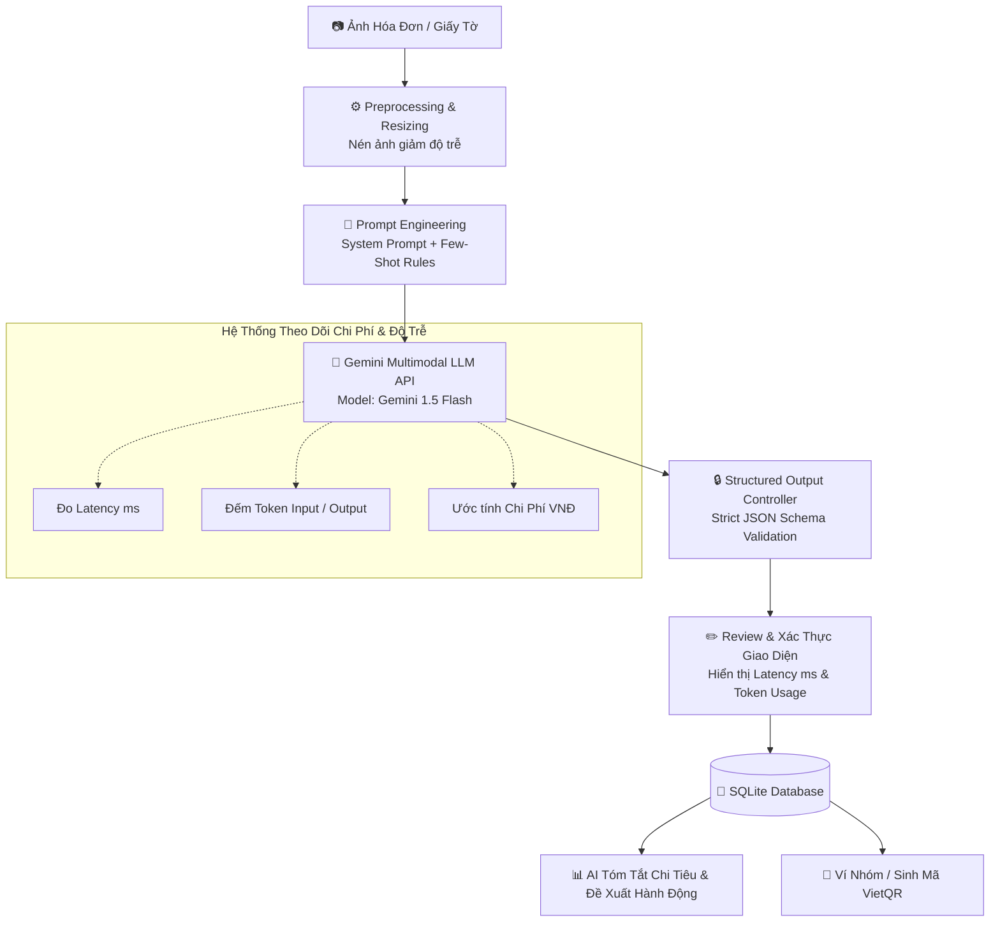

# 👛 VÍ XINH — Ứng Dụng Quản Lý Tài Chính & Trích Xuất Dữ Liệu Hóa Đơn Bằng Mô Hình Ngôn Ngữ Lớn (LLM API)

> **Đồ án Thực tập Chuyên môn** — Lớp **23CN1** — **Nhóm 05**  
> **Định hướng Đề tài:** **Hướng 3 — Ứng dụng dùng Model Ngôn ngữ lớn qua API (Gemini API)**  
> **Trọng tâm Nghiên cứu:** Thiết kế lời nhắc (Prompt Engineering), Kiểm soát định dạng đầu ra (Structured JSON Output), và Xử trị Chi phí & Độ trễ (Cost & Latency Optimization).

---

## ✨ Tính Năng Nổi Bật Của Hệ Thống

- 🤖 **Trích xuất thông tin có cấu trúc bằng LLM Multimodal:** Tiếp nhận ảnh chụp hóa đơn / chứng từ thực tế (siêu thị, quán ăn, nhà hàng, hóa đơn phòng trọ), sử dụng Gemini API từ Backend để đọc hiểu ngữ nghĩa và bóc tách đầy đủ: Tên nơi bán, Ngày giờ giao dịch, Chi tiết danh sách từng món hàng (`Tên sản phẩm`, `Số lượng`, `Đơn giá`, `Thành tiền`), `Tiền giảm giá`, `Thuế VAT` và `Phân loại danh mục tự động`.
- 🎯 **Prompt Engineering & Kiểm soát định dạng đầu ra (JSON Schema):** Thiết kế System Prompt chuẩn mực cho chuyên gia dữ liệu tài chính, áp dụng kỹ thuật Few-shot Prompting kết hợp ràng buộc định dạng đầu ra JSON (Structured Output), loại bỏ hoàn toàn lỗi hallucination và markdown rác, đảm bảo dữ liệu chuẩn hóa 100% để lưu trực tiếp vào CSDL SQLite.
- ⚡ **Tối ưu Hóa Chi Phí & Độ Trễ (Cost & Latency Management):**
  - Khai thác dòng mô hình phản hồi siêu tốc và tiết kiệm chi phí (`gemini-1.5-flash` / `gemini-flash-latest`).
  - Tiền xử lý, tối ưu hóa kích thước và nén ảnh trước khi truyền qua mạng nhằm giảm thiểu băng thông và latency.
  - Đo lường và hiển thị trực quan thông số vận hành: **Thời gian xử lý (Latency - ms)**, **Số lượng Token tiêu thụ (Input/Output Tokens)** và **Ước tính chi phí API ($ / VNĐ)** trực tiếp trên giao diện kiểm tra.
- 💡 **AI Tóm tắt & Đề xuất Hành động Tài chính (Spending Summary & Financial Advice):** Mô hình đọc hiểu lịch sử chi tiêu cá nhân/nhóm trong tháng, tự động tóm tắt 3 khoản chi tiêu lớn nhất, cảnh báo danh mục vượt định mức và đề xuất 3 hành động thực tế giúp tiết kiệm ngân sách.
- 👥 **Quỹ nhóm & Chia tiền linh hoạt:** Quản lý chi tiêu minh bạch, chia đều hoặc chia theo món, tính toán công nợ và tự động tạo mã thanh toán chuẩn **VietQR**.
- 🌐 **Kiến trúc Đa nền tảng:** Hỗ trợ Web Demo Fullstack (Flask Backend + PWA Client) và Mobile App Native (Flutter cho Android & iOS).

---

## 👥 Phân Công Nhiệm Vụ Thành Viên (Theo Chuẩn Hướng 3)

| STT | Thành Viên | Module Phụ Trách | Nhiệm Vụ Chi Tiết |
|:---:|:---|:---|:---|
| 1 | **Nguyễn Thúy Hiền** | **Prompt Engineering & Model Evaluator** | Thiết kế System Prompt, Zero-shot & Few-shot Prompts trích xuất hóa đơn; xây dựng bộ dữ liệu kiểm thử (Golden Dataset) và đánh giá độ chính xác của các phiên bản Prompt. |
| 2 | **Lê Thị Dịu** | **Database & Financial Logic** | Thiết kế CSDL SQLite lưu trữ JSON có cấu trúc; xây dựng logic quản lý tài chính, thuật toán quỹ nhóm, chia tiền linh hoạt và đồng bộ giao dịch. |
| 3 | **Lê Tiến Quân** | **Structured Output & Schema Validation** | Xây dựng JSON Schema / Pydantic Validator kiểm soát định dạng đầu ra; cài đặt cơ chế kiểm tra tính toàn vẹn dữ liệu (SL × Đơn giá = Thành tiền, Thuế VAT, Giảm giá) và fallback tự động. |
| 4 | **Lê Ngọc Duy** | **Giao Diện UI/UX (Web & Flutter)** | Thiết kế giao diện Dashboard tương tác, bảng xác thực dữ liệu hóa đơn 4 cột, hiển thị trực quan số liệu độ trễ (ms), token usage, chi phí và giao diện AI tư vấn tài chính. |
| 5 | **Nguyễn Việt Anh** | **LLM Backend & Cost/Latency Optimization** | Tích hợp Gemini API từ backend Flask, cài đặt thuật toán nén ảnh giảm latency, theo dõi token count / chi phí API, thiết kế API tóm tắt chi tiêu & đề xuất hành động, quản trị CI/CD. |

---

## 🏗️ Kiến Trúc Xử Lý Kỹ Thuật (Pipeline Hướng 3)



---

## 📂 Cấu Trúc Dự Án (Monorepo)

```
Ví Xinh/
├── docs/                        # Tài liệu kiến trúc, đặc tả CSDL & phân công
│   ├── pipeline_architecture.md # Luồng kỹ thuật LLM Information Extraction
│   └── database_design.md       # Thiết kế CSDL SQLite
├── data/                        # Hóa đơn mẫu & bộ ảnh kiểm thử
├── phase-1-web-demo/            # [Phase 1] Ứng dụng Web PWA Fullstack
│   ├── backend/                 # API Flask, Gemini LLM Engine, SQLite
│   │   ├── llm/                 # Module tích hợp Gemini Multimodal API (Prompt, Latency & Cost)
│   │   ├── extractor/           # Validator & Bộ bóc tách dữ liệu có cấu trúc
│   │   └── prompts/             # Bộ Prompt tài chính & JSON Schema chuẩn
│   ├── frontend/                # Giao diện Web PWA (Dashboard, Review, AI Stats)
│   └── run.py                   # Script khởi chạy Web Server
├── phase-2-mobile-app/          # [Phase 2] Ứng dụng Di Động Flutter (Android / iOS)
│   └── lib/                     # Giao diện Flutter & Kết nối Backend API
├── tests/                       # Bộ kiểm thử tự động (Unit Tests)
├── CONTRIBUTING.md              # Quy tắc làm việc nhóm & chuẩn Git
└── README.md
```

---

## 🚀 Hướng Dẫn Khởi Chạy Nhanh

### 🌐 1. Chạy Web Demo (Phase 1)
```bash
cd phase-1-web-demo
python -m venv venv
# Kích hoạt trên Windows: .\venv\Scripts\activate
pip install -r requirements.txt

# Cấu hình Google Gemini API Key trong file .env:
# GOOGLE_API_KEY=AIzaSy...

python run.py
```
👉 Truy cập giao diện tại: `http://localhost:5000`.

---

### 📱 2. Chạy Mobile App Flutter (Phase 2)
```bash
cd phase-2-mobile-app
flutter pub get

# Chạy trên thiết bị thử nghiệm:
flutter run

# Xuất file cài đặt Android APK:
flutter build apk --release
```

---

## 📑 Tài Liệu Tham Khảo Thêm
* [Kiến Trúc Pipeline Xử Lý LLM & Structured Output](file:///c:/Users/Lenovo/Downloads/Ví%20Xinh/docs/pipeline_architecture.md)
* [Đặc Tả Cơ Sở Dữ Liệu & ERD](file:///c:/Users/Lenovo/Downloads/Ví%20Xinh/docs/database_design.md)
* [Quy Ước Đóng Góp & Git Workflow](file:///c:/Users/Lenovo/Downloads/Ví%20Xinh/CONTRIBUTING.md)
