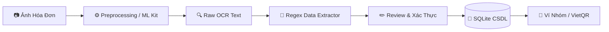

# 👛 VÍ XINH — Ứng Dụng Quản Lý Tài Chính & OCR Hóa Đơn Thông Minh

<p align="center">
  
  
  
  
  
</p>

> **Đồ án Thực tập Chuyên môn** — Lớp **23CN1** — **Nhóm 05**  
> Quản lý chi tiêu cá nhân và quỹ nhóm tự động với công nghệ Thị giác máy tính & OCR bóc tách hóa đơn siêu tốc.

---

## ✨ Tính Năng Nổi Bật

- 📸 **Bóc tách hóa đơn tự động (OCR):** Tự động nhận diện Tên cửa hàng, Ngày giờ, Tổng tiền trong **< 300ms** (100% on-device qua Google ML Kit / OpenCV & Tesseract).
- 👥 **Quỹ nhóm & Chia tiền linh hoạt:** Hỗ trợ tính năng chia đều, chia theo định mức, quản lý nợ phòng trọ và tự động tạo mã **VietQR** nhắc nợ.
- 📊 **Thống kê & Báo cáo trực quan:** Biểu đồ cơ cấu chi tiêu trực quan, phân loại danh mục thông minh.
- 🌐 **Đa nền tảng:** Hỗ trợ chạy song song **Web Demo (PWA)** và **Mobile App Native (Flutter cho Android & iOS)**.

---

## 👥 Phân Công Nhiệm Vụ Thành Viên

| STT | Thành Viên | Module Phụ Trách | Giai Đoạn 1 (Web MVP) | Giai Đoạn 2 (Mobile App) |
|:---:|:---|:---|:---|:---|
| 1 | **Nguyễn Thúy Hiền** | **OCR & Vision** | OpenCV Preprocessing + Tesseract OCR | Google ML Kit On-Device + Camera Scanner |
| 2 | **Lê Thị Dịu** | **Database & Quỹ Nhóm** | SQLite Schema + Logic chia tiền ví nhóm | SQLite `sqflite` Local + Sync công nợ |
| 3 | **Lê Tiến Quân** | **Regex Extractor** | Bộ quy tắc Regex bóc tách Cửa hàng, Ngày, Tiền | Porting Regex sang Dart + xử lý hóa đơn mờ |
| 4 | **Lê Ngọc Duy** | **Giao Diện UI/UX** | Web PWA Dashboard + Review OCR Screen | Flutter UI Siêu ứng dụng (Dark/Rose Gold UI) |
| 5 | **Nguyễn Việt Anh** | **Hệ Thống & CI/CD** | Tích hợp API Backend & Pipeline kết nối | Build Mobile, config Gradle/iOS & kiểm thử |

> 📖 *Chi tiết kế hoạch và phân công:* [docs/phan_cong_nhiem_vu.md](file:///c:/Users/Lenovo/Downloads/Ví%20Xinh/docs/phan_cong_nhiem_vu.md)

---

## 🏗️ Kiến Trúc Xử Lý Kỹ Thuật (Pipeline)



---

## 📂 Cấu Trúc Dự Án (Monorepo)

```
Ví Xinh/
├── docs/                        # Tài liệu đặc tả phân công, kiến trúc CSDL & Pipeline
│   ├── phan_cong_nhiem_vu.md    # Phân công chi tiết từng thành viên
│   ├── pipeline_architecture.md # Luồng xử lý kỹ thuật OCR & Regex
│   └── database_design.md       # Thiết kế CSDL (SQLite ERD)
├── data/                        # Dữ liệu kiểm thử & mẫu hóa đơn thực tế
│   └── sample_receipts/         # Hóa đơn test (Rõ nét, mờ, góc nghiêng)
├── phase-1-web-demo/            # [Phase 1] Ứng dụng Web PWA Fullstack
│   ├── backend/                 # API Flask, OCR Tesseract & SQLite
│   ├── frontend/                # Giao diện HTML5, CSS3, JS & PWA Service Worker
│   └── run.py                   # Script khởi chạy Web Server
├── phase-2-mobile-app/          # [Phase 2] Ứng dụng Di Động Flutter (Android / iOS)
│   ├── lib/                     # Mã nguồn Flutter (Dart) & Google ML Kit
│   └── pubspec.yaml             # Cấu hình thư viện di động
├── tests/                       # Bộ kiểm thử tự động (Unit Tests)
├── CONTRIBUTING.md              # Quy tắc làm việc nhóm & chuẩn Git Commit
└── README.md
```

---

## 🚀 Hướng Dẫn Khởi Chạy Nhanh

### 🌐 1. Chạy Web Demo (Phase 1)
```bash
cd phase-1-web-demo
python -m venv venv
# Kích hoạt trên Windows: .\venv\Scripts\activate
pip install -r requirements.txt
python run.py
```
👉 Truy cập giao diện tại: `http://localhost:5000` *(hoặc mở bằng điện thoại cùng mạng Wi-Fi)*.

---

### 📱 2. Chạy Mobile App Flutter (Phase 2)
```bash
cd phase-2-mobile-app
flutter pub get

# Chạy trên thiết bị giả lập hoặc điện thoại thật:
flutter run

# Xuất file cài đặt Android APK:
flutter build apk --release
```

---

## 📑 Tài Liệu Tham Khảo Thêm
* [Kiến Trúc Pipeline Xử Lý Kỹ Thuật](file:///c:/Users/Lenovo/Downloads/Ví%20Xinh/docs/pipeline_architecture.md)
* [Đặc Tả Cơ Sở Dữ Liệu & ERD](file:///c:/Users/Lenovo/Downloads/Ví%20Xinh/docs/database_design.md)
* [Quy Ước Đóng Góp & Git Workflow](file:///c:/Users/Lenovo/Downloads/Ví%20Xinh/CONTRIBUTING.md)
* [Hướng Dẫn Chi Tiết Phase 2 Mobile](file:///c:/Users/Lenovo/Downloads/Ví%20Xinh/phase-2-mobile-app/README.md)
