# 👛 VÍ XINH - Ứng Dụng Quản Lý Tài Chính Cá Nhân & Nhóm Sử Dụng Thị Giác Máy Tính & OCR

> **Đồ án Thực tập Chuyên môn**  
> **Lớp:** 23CN1 — **Nhóm:** 05  
> **Tên ứng dụng:** Ví Xinh  
> **Mục tiêu:** Xây dựng ứng dụng quản lý chi tiêu thông minh cho cá nhân và nhóm, tự động bóc tách thông tin từ hóa đơn (tên quán, ngày giờ, số tiền) bằng công nghệ xử lý ảnh và OCR, hỗ trợ chia tiền nhóm tự động.

---

## 👥 1. Danh Sách Thành Viên & Phân Công Nhiệm Vụ

Dự án được chia theo 5 module chính tương ứng với 5 thành viên qua 2 giai đoạn:

| STT | Thành Viên | Vai Trò Chính | Nhiệm Vụ Giai Đoạn 1 (Web MVP) | Nhiệm Vụ Giai Đoạn 2 (Mobile App) |
|:---:|:---|:---|:---|:---|
| 1 | **Nguyễn Thúy Hiền** | Tích hợp OCR & Tiền Xử Lý Ảnh | Thiết lập OCR pipeline (Tesseract/EasyOCR), tiền xử lý ảnh (OpenCV) | Chuyển đổi sang Google ML Kit OCR on-device, tối ưu camera scan |
| 2 | **Lê Thị Dịu** | Database & Logic Ví Nhóm | Thiết kế CSDL (SQLite), xây dựng logic ví nhóm & chia tiền | Đồng bộ CSDL lên mobile, đồng bộ offline-to-online & bảo mật |
| 3 | **Lê Tiến Quân** | NLP / Regex & Bóc Tách Dữ Liệu | Xây dựng bộ quy tắc Regex bóc tách Cửa hàng, Ngày, Tổng tiền | Tối ưu bộ trích xuất, xử lý ngoại lệ hóa đơn mờ, sai định dạng |
| 4 | **Lê Ngọc Duy** | Thiết Kế & Lập Trình UI/UX | Xây dựng giao diện Web Demo (Dashboard, Màn hình Review OCR) | Thiết kế & code App Di Động (Flutter/Native UI) mượt mà |
| 5 | **Nguyễn Việt Anh** | Hệ Thống & Tích Hợp Kỹ Thuật | Phối hợp tích hợp API Backend giữa OCR, Parser, CSDL & UI | Quản lý build mobile, CI/CD, giải quyết xung đột đa nền tảng |

> 📌 **Công việc chung toàn nhóm:** Cùng thu thập tập dữ liệu ảnh hóa đơn thực tế (ảnh rõ, mờ, góc nghiêng), tham gia kiểm thử hệ thống (QA), đo lường độ chính xác và viết Báo cáo / Slide thuyết trình.

---

## 🚀 2. Lộ Trình Triển Khai 2 Giai Đoạn

```mermaid
graph TD
    subgraph "Giai đoạn 1: Web Demo (MVP)"
        A1[Ảnh Hóa Đơn] --> A2[OpenCV Preprocessing]
        A2 --> A3[OCR Engine Python]
        A3 --> A4[Regex Data Extractor]
        A4 --> A5[Màn hình Review / Chỉnh sửa]
        A5 --> A6[CSDL SQLite + Dashboard Web]
    end

    subgraph "Giai đoạn 2: Mobile Application"
        B1[Camera Di Động] --> B2[Google ML Kit On-Device]
        B2 --> B3[Regex Mobile Extractor]
        B3 --> B4[UI Siêu Ứng Dụng Flutter]
        B4 --> B5[Sync Database & Push Notification]
    end
```



### 🔹 Giai đoạn 1: Web Demo (MVP)
- **Mục tiêu:** Kiểm chứng thuật toán trích xuất dữ liệu hóa đơn, hoàn thiện logic quản lý ví nhóm/chia tiền và demo báo cáo tiến độ.
- **Công nghệ:** Python (Flask/FastAPI), OpenCV, Tesseract/EasyOCR, SQLite, HTML5/CSS3/JavaScript hiện đại.

### 🔹 Giai đoạn 2: Ứng dụng Di Động Hoàn Chỉnh
- **Mục tiêu:** Sản phẩm hoàn chỉnh trên Android/iOS, thao tác chụp ảnh hóa đơn siêu tốc không phụ thuộc mạng nhờ ML Kit on-device.
- **Công nghệ:** Flutter / React Native / Kotlin / Swift + Google ML Kit Text Recognition.

---

## 🔄 3. Quy Trình Xử Lý Kỹ Thuật (Pipeline)

1. **Thu nhận ảnh:** Người dùng tải ảnh hóa đơn (Web) hoặc chụp trực tiếp từ Camera (Mobile).
2. **Tiền xử lý & Nhận diện (OCR):** Cân chỉnh góc nghiêng (deskew), tăng tương phản, chuyển grayscale và trích xuất raw text.
3. **Bóc tách thông tin (Regex Parsing):** Nhận diện tự động:
   - Tên cơ sở/cửa hàng
   - Thời gian/ngày giao dịch
   - Tổng tiền thanh toán
4. **Màn hình xác thực (Review Screen):** Cho phép người dùng duyệt và sửa đổi thông tin trong vài giây nếu nhận diện thiếu hoặc sai.
5. **Lưu trữ & Thống kê:** Ghi nhận vào ví cá nhân hoặc tự động tính toán số tiền chia cho các thành viên trong ví nhóm.

---

## 📂 4. Cấu Trúc Thư Mục Repository

```
Ví Xinh/
├── docs/                        # Tài liệu đặc tả, phân công, kiến trúc CSDL
│   ├── phan_cong_nhiem_vu.md
│   ├── pipeline_architecture.md
│   └── database_design.md
├── data/                        # Dữ liệu mẫu phục vụ kiểm thử
│   ├── sample_receipts/         # Hóa đơn test (rõ nét, mờ, góc nghiêng)
│   └── uploads/                 # Thư mục lưu ảnh tạm
├── phase-1-web-demo/            # [Giai đoạn 1] Mã nguồn Web MVP
│   ├── backend/
│   │   ├── ocr/                 # [Thành viên 1] Xử lý ảnh & OCR engine
│   │   ├── database/            # [Thành viên 2] SQLite & Logic chia tiền nhóm
│   │   ├── extractor/           # [Thành viên 3] Regex bóc tách trường dữ liệu
│   │   ├── core/                # [Thành viên 5] Pipeline kết nối & Config
│   │   └── app.py               # API Server chính
│   ├── frontend/                # [Thành viên 4] Giao diện Web Dashboard & Review
│   └── requirements.txt         # Thư viện phụ thuộc Python
├── phase-2-mobile-app/          # [Giai đoạn 2] Cấu trúc ứng dụng di động
│   └── README.md
├── tests/                       # [Toàn nhóm] Bộ kiểm thử tự động
└── README.md
```

---

## 💻 5. Hướng Dẫn Cài Đặt & Chạy Thử (Giai Đoạn 1)

### Yêu cầu tiên quyết
- Python 3.10+ đã được cài đặt
- Git

### Các bước khởi chạy:
```bash
# 1. Di chuyển vào thư mục Web Demo
cd phase-1-web-demo

# 2. Tạo môi trường ảo (khuyến nghị)
python -m venv venv
# Kích hoạt trên Windows:
.\venv\Scripts\activate

# 3. Cài đặt các thư viện phụ thuộc
pip install -r requirements.txt

# 4. Khởi chạy server ứng dụng
python run.py
```
Sau đó mở trình duyệt tại: `http://localhost:5000`

---

## 🤝 6. Quy Ước Đóng Góp (Git Workflow)
Vui lòng xem chi tiết tại [CONTRIBUTING.md](file:///c:/Users/Lenovo/Downloads/V%C3%AD%20Xinh/CONTRIBUTING.md) để nắm rõ:
- Quy tắc đặt tên nhánh: `feature/<tên-thành-viên>-<tên-chức-năng>`
- Chuẩn viết commit: `feat:`, `fix:`, `docs:`, `refactor:`, `test:`
