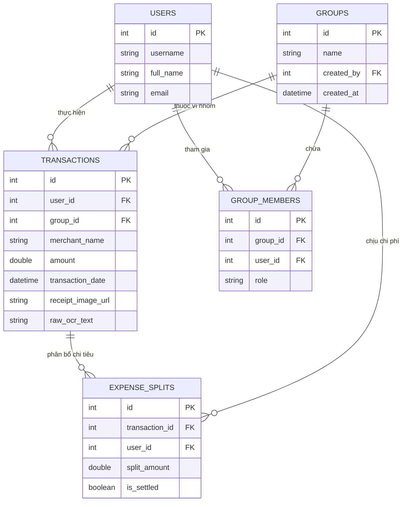

# 🗄️ THIẾT KẾ CƠ SỞ DỮ LIỆU "VÍ XINH"

Hệ thống sử dụng cơ sở dữ liệu quan hệ chuẩn hóa (SQLite trên Web Backend và `sqflite` trên Mobile Local Storage).

---

## 1. Sơ Đồ Thực Thể Liên Kết (ERD)

---

## 2. Đặc Tả Các Bảng Dữ Liệu Chính

| Tên Bảng | Ý Nghĩa | Các Trường Quan Trọng |
|:---|:---|:---|
| **`users`** | Tài khoản người dùng | `id`, `username`, `full_name`, `email`, `created_at` |
| **`groups`** | Ví nhóm / Quỹ phòng trọ | `id`, `name`, `created_by`, `created_at` |
| **`group_members`**| Danh sách thành viên ví nhóm | `id`, `group_id` (FK), `user_id` (FK), `role` (`admin`/`member`) |
| **`transactions`** | Giao dịch thu / chi | `id`, `user_id` (FK), `group_id` (FK, nullable), `merchant_name`, `amount`, `transaction_date`, `raw_ocr_text` |
| **`expense_splits`**| Phân bổ công nợ chia tiền | `id`, `transaction_id` (FK), `user_id` (FK), `split_amount`, `is_settled` (boolean) |
