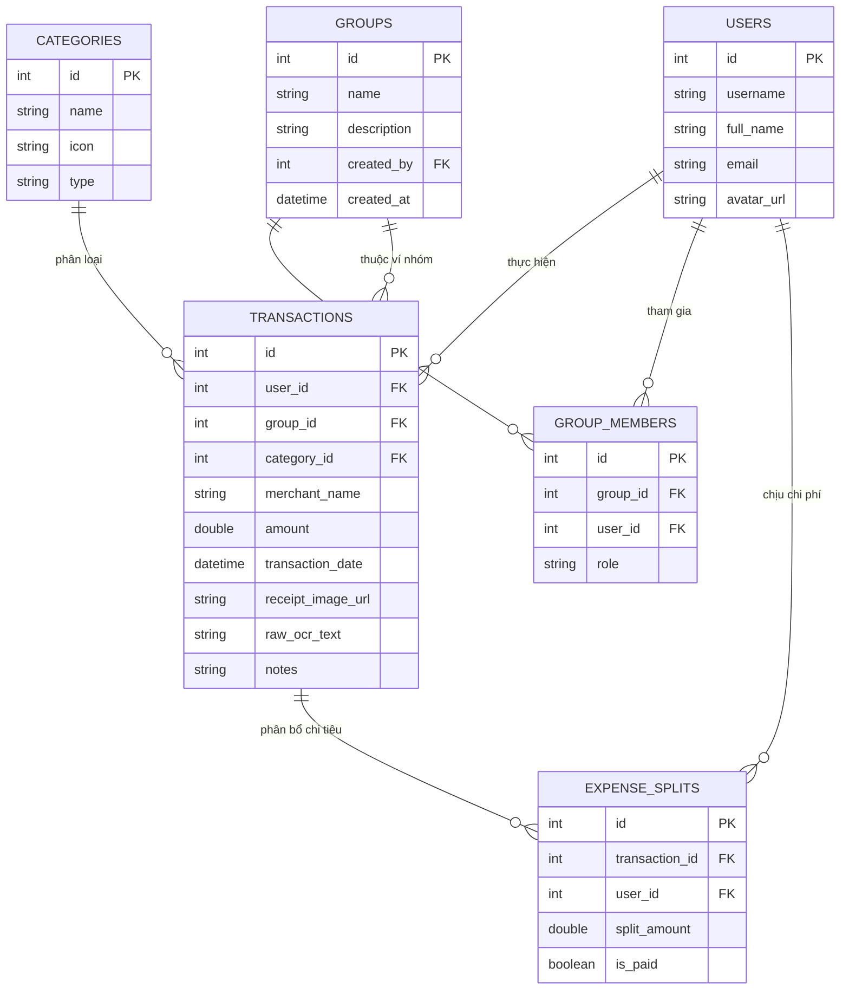

# 🗄️ THIẾT KẾ CƠ SỞ DỮ LIỆU "VÍ XINH"

Hệ thống hỗ trợ CSDL quan hệ chuẩn hóa (SQLite cho giai đoạn Web Demo & Mobile SQLite/Room/Isar cho giai đoạn Mobile).

---

## 1. Sơ Đồ Thực Thể Liên Kết (ERD)

---

## 2. Chi Tiết Các Bảng

### 2.1. Bảng `users` (Người dùng)
- `id`: INTEGER PRIMARY KEY AUTOINCREMENT
- `username`: VARCHAR(50) UNIQUE NOT NULL
- `full_name`: VARCHAR(100) NOT NULL
- `email`: VARCHAR(100)
- `created_at`: TIMESTAMP DEFAULT CURRENT_TIMESTAMP

### 2.2. Bảng `groups` (Ví nhóm)
- `id`: INTEGER PRIMARY KEY AUTOINCREMENT
- `name`: VARCHAR(100) NOT NULL (Ví dụ: "Phòng Trọ 302", "Chuyến Đi Đà Lạt")
- `created_by`: INTEGER FOREIGN KEY -> `users(id)`
- `created_at`: TIMESTAMP DEFAULT CURRENT_TIMESTAMP

### 2.3. Bảng `group_members` (Thành viên ví nhóm)
- `id`: INTEGER PRIMARY KEY AUTOINCREMENT
- `group_id`: INTEGER FOREIGN KEY -> `groups(id)`
- `user_id`: INTEGER FOREIGN KEY -> `users(id)`
- `role`: VARCHAR(20) DEFAULT 'member' (admin / member)

### 2.4. Bảng `transactions` (Giao dịch thu/chi)
- `id`: INTEGER PRIMARY KEY AUTOINCREMENT
- `user_id`: INTEGER FOREIGN KEY -> `users(id)` (người trả tiền ban đầu)
- `group_id`: INTEGER NULL FOREIGN KEY -> `groups(id)` (NULL nếu là chi tiêu cá nhân)
- `merchant_name`: VARCHAR(255) (Tên quán trích xuất từ OCR hoặc nhập tay)
- `amount`: REAL NOT NULL (Số tiền thanh toán)
- `transaction_date`: DATE NOT NULL
- `receipt_image_path`: VARCHAR(255) (Đường dẫn ảnh hóa đơn gốc)
- `raw_ocr_text`: TEXT (Lưu văn bản thô OCR để tái phân tích hoặc kiểm thử)
- `created_at`: TIMESTAMP DEFAULT CURRENT_TIMESTAMP

### 2.5. Bảng `expense_splits` (Chi tiết chia tiền)
- `id`: INTEGER PRIMARY KEY AUTOINCREMENT
- `transaction_id`: INTEGER FOREIGN KEY -> `transactions(id)`
- `user_id`: INTEGER FOREIGN KEY -> `users(id)` (người cần thanh toán khoản chia)
- `split_amount`: REAL NOT NULL
- `is_settled`: BOOLEAN DEFAULT 0 (đã trả nợ chưa)
