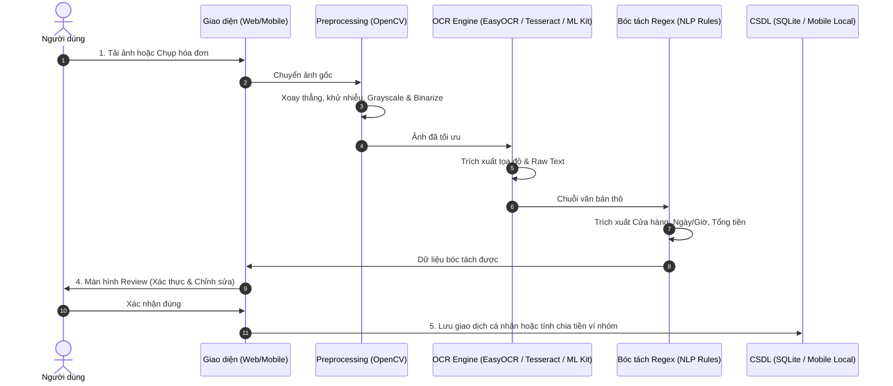

# 🏗️ KIẾN TRÚC HỆ THỐNG & PIPELINE XỬ LÝ KỸ THUẬT

## 1. Sơ Đồ Pipeline 5 Bước Hoàn Chỉnh

Hệ thống xử lý hóa đơn tự động của **Ví Xinh** bao gồm 5 giai đoạn liên tiếp:

---

## 2. Chi Tiết Từng Giai Đoạn

### Bước 1: Thu Nhận Ảnh (Image Ingestion)
- **Web Demo:** Hỗ trợ drag & drop hoặc chọn file `JPG, PNG, WEBP, PDF`. Kiểm tra kích thước và định dạng hợp lệ.
- **Mobile App:** Sử dụng Camera Controller với khung hướng dẫn đặt hóa đơn, tự động căn góc và chụp.

### Bước 2: Tiền Xử Lý Ảnh & OCR (Computer Vision & Text Recognition)
- **Web Demo (Môi trường máy chủ/Python):**
  - Chuyển đổi ảnh sang thang xám (Grayscale), khử bóng bằng Morphology.
  - Lọc nhiễu Gaussian Blur / Bilateral Filter.
  - Cân chỉnh góc nghiêng (Deskew) dựa trên phép biến đổi Hough Transform hoặc MinAreaRect.
  - Áp dụng Adaptive Thresholding (Otsu) để làm nổi bật nét chữ in nhiệt.
  - Chạy Tesseract OCR Engine (`vie+eng`) để trích xuất văn bản thô.

- **Mobile App Flutter (Google ML Kit On-Device):**
  - Sử dụng thư viện `google_mlkit_text_recognition: ^0.11.0` với model `TextRecognitionScript.latin`.
  - **100% On-Device:** Nhận diện ký tự trực tiếp trên NPU/CPU của smartphone, hoàn toàn không cần kết nối Internet, bảo vệ tối đa dữ liệu tài chính người dùng.
  - Tự động tách `RecognizedText` theo cấu trúc: `TextBlock` → `TextLine` → `TextElement`.
  - Hỗ trợ trích xuất tọa độ Bounding Box, kiểm tra góc quay của chữ tự động mà không cần tiền xử lý phức tạp.
  - Thời gian phản hồi siêu tốc (< 150ms trên cả Android và iOS).

### Bước 3: Thuật Toán Xử Lý Hậu Kỳ & Trích Xuất Dữ Liệu (Regex Extractor)
- **Tên cửa hàng (Merchant Name):**
  - Thường nằm ở 1 - 3 dòng đầu tiên của hóa đơn.
  - Lọc bỏ các từ vô nghĩa, so khớp với danh mục chuỗi cửa hàng phổ biến (Highlands, Circle K, WinMart, Phúc Long,...).
- **Ngày giao dịch (Transaction Date):**
  - Regex nhận diện các định dạng: `DD/MM/YYYY`, `DD-MM-YYYY`, `YYYY-MM-DD`, kèm giờ phút `HH:mm:ss`.
- **Tổng tiền (Total Amount):**
  - Tìm kiếm các từ khóa lân cận: `Tổng cộng`, `Thành tiền`, `TOTAL`, `Tong tien`, `Thanh toan`, `Cash`, `VNĐ`, `VND`.
  - Phân tích số tiền bằng regex xử lý dấu phẩy, dấu chấm hàng nghìn (ví dụ: `150.000 đ`, `150,000`).

### Bước 4: Màn Hình Xác Thực (Review & Correction UI)
- Hiển thị ảnh hóa đơn song song với form nhập liệu.
- Làm nổi bật các trường trích xuất được.
- Đánh dấu mức độ tin cậy (Confidence score).
- Cho phép người dùng chỉnh sửa nhanh bằng 1 chạm trước khi lưu.

### Bước 5: Lưu Trữ CSDL & Tính Toán Ví Nhóm (Storage & Split Engine)
- Ghi nhận vào bảng `transactions`.
- Nếu chọn vào Ví Nhóm (`group_wallet`):
  - Chia đều (Equal Split): $Số tiền / n$ thành viên.
  - Chia theo phần trăm hoặc số tiền thực tế tiêu thụ.
- Cập nhật số dư tức thời trên biểu đồ Dashboard.
