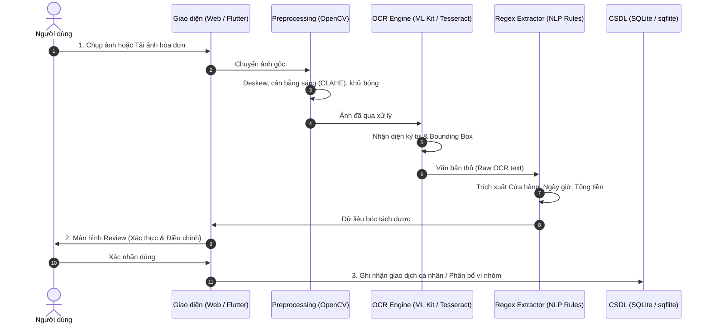

# KIẾN TRÚC PIPELINE XỬ LÝ KỸ THUẬT

Hệ thống xử lý hóa đơn tự động của **Ví Xinh** bao gồm 5 bước liên hoàn từ thu nhận ảnh đến phân bổ tài chính:

---

## Chi Tiết 5 Bước Xử Lý

### 1. Thu Nhận Ảnh (Image Ingestion)
* **Web Demo:** Hỗ trợ kéo thả hoặc tải file (`JPG`, `PNG`, `WEBP`).
* **Mobile App:** Camera scanner toàn màn hình có khung định vị hóa đơn, hỗ trợ bật đèn Flash và lấy nét tức thì.

### 2. Tiền Xử Lý & OCR (Vision Engine)
* **Môi trường Web (Python):**
  * Tự động xoay thẳng ảnh (`Deskew` qua MinAreaRect).
  * Khử bóng đổ phức tạp (`Morphology`) và nhị phân hóa thích nghi (`Otsu Adaptive Thresholding`).
  * Gọi mô hình OCR nhận diện tiếng Việt (`vie+eng`).
* **Môi trường Mobile (Flutter):**
  * Tích hợp **Google ML Kit Text Recognition** (`TextRecognitionScript.latin`).
  * Xử lý **100% On-Device** trên chip điện thoại, tốc độ phản hồi cực nhanh (< 200ms) và bảo vệ an toàn thông tin cá nhân.

### 3. Trích Xuất Dữ Liệu Bằng Biểu Thức Chính Quy (Regex Parser)
* **Tên cửa hàng (Merchant):** Phân tích 3 dòng đầu hóa đơn, kết hợp từ điển nhận diện các thương hiệu thông dụng (Highlands, WinMart, Circle K, Phúc Long,...).
* **Ngày giao dịch (Date):** Hỗ trợ đa dạng format (`DD/MM/YYYY`, `DD-MM-YYYY`, `YYYY-MM-DD`, giờ phút `HH:mm:ss`).
* **Tổng tiền (Amount):** Dò tìm từ khóa ngữ nghĩa lân cận (`Tổng cộng`, `Thành tiền`, `TOTAL`, `VNĐ`, `đ`) và xử lý định dạng phân cách thập phân/hàng nghìn.

### 4. Màn Hình Review & Chỉnh Sửa Nhanh (Review Screen)
* Hiển thị ảnh chụp song song với form dữ liệu bóc tách được.
* Gán độ tin cậy (Confidence Score) cho từng trường để người dùng an tâm hoặc sửa nhanh bằng 1 chạm.

### 5. Ghi Nhận & Chia Tiền Nhóm (Storage & Split Engine)
* Lưu trữ an toàn trong CSDL SQLite.
* Nếu thuộc **Ví Nhóm**: Tự động tính toán số tiền chia theo đầu người, hiển thị bảng công nợ và tự động sinh mã thanh toán **VietQR**.
