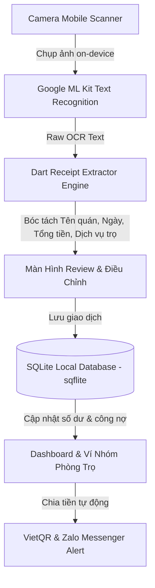

# 📱 GIAI ĐOẠN 2: ỨNG DỤNG DI ĐỘNG HOÀN CHỈNH "VÍ XINH" (FLUTTER & GOOGLE ML KIT)

> Phụ trách: **Cả 5 thành viên chuyển đổi từ Web sang Mobile theo phân công đồ án.**

---

## 🎯 1. Tổng Quan Kiến Trúc Ứng Dụng Mobile

Ứng dụng di động **Ví Xinh** được phát triển trên nền tảng **Flutter 3.x** đa nền tảng (Android & iOS), ứng dụng trực tiếp công nghệ **Google ML Kit Text Recognition on-device** cho tốc độ bóc tách tức thì (< 500ms) không cần gửi ảnh lên server.



---

## 📂 2. Cấu Trúc Mã Nguồn Mobile (`phase-2-mobile-app`)

```
phase-2-mobile-app/
├── pubspec.yaml                 # Cấu hình dependencies: camera, google_mlkit, sqflite, provider
├── README.md                    # Tài liệu kỹ thuật giai đoạn 2
├── android/                     # Cấu hình Android native (AndroidManifest, permissions, ML Kit)
└── lib/
    ├── main.dart                # Điểm khởi chạy Flutter App & MultiProvider
    ├── core/
    │   ├── constants/
    │   │   └── app_colors.dart  # Bảng màu Rose Gold & Gradients chuẩn thiết kế Ví Xinh
    │   └── utils/
    │       └── currency_formatter.dart # Định dạng tiền tệ VNĐ chuẩn xác
    ├── models/
    │   ├── transaction_model.dart # Cấu trúc giao dịch & LineItem dịch vụ phòng trọ
    │   ├── user_model.dart        # Thông tin tài khoản người dùng
    │   └── group_model.dart       # Cấu trúc ví nhóm, quỹ phòng & công nợ thành viên
    ├── services/
    │   ├── mlkit_ocr_service.dart # Google ML Kit on-device
    │   └── database_helper.dart   # [Thành viên 2 - Thị Dịu] SQLite sqflite local persistence
    ├── extractor/
    │   └── dart_receipt_extractor.dart # [Thành viên 3 - Tiến Quân] Porting thuật toán Regex sang Dart
    ├── providers/
    │   ├── wallet_provider.dart   # Quản lý số dư ví cá nhân, thu chi & giao dịch
    │   └── group_provider.dart    # Quản lý số dư quỹ chi tiêu nhóm & nộp quỹ
    └── screens/
        ├── camera/
        │   └── receipt_scanner_screen.dart # Camera scanner có khung định vị hóa đơn
        ├── review/
        │   └── review_receipt_screen.dart  # Màn hình review hóa đơn, chia nhanh N người / ví nhóm
        ├── group/
        │   └── group_wallet_screen.dart    # Quỹ phòng trọ, danh sách nợ & VietQR nhắc nợ
        ├── profile/
        │   └── profile_screen.dart         # Thông tin cá nhân, STK VietQR, bảo mật sinh trắc học
        └── home/
            └── dashboard_screen.dart       # Trang chủ Siêu Ứng Dụng Ví Xinh
```

---

## 👥 3. Phân Công Trách Nhiệm Thành Viên Giai Đoạn 2

| Thành Viên | Phụ Trách Kỹ Thuật | Module Hoàn Thành |
|:---|:---|:---|
| **Thành viên 1** | Model OCR On-Device & Camera Scan | `services/mlkit_ocr_service.dart`, `screens/camera/receipt_scanner_screen.dart` |
| **Lê Thị Dịu** | CSDL SQLite Local & Logic Quỹ Nhóm | `services/database_helper.dart`, `models/group_model.dart`, logic tính nợ phòng trọ |
| **Lê Tiến Quân** | Regex Extractor Porting sang Dart | `extractor/dart_receipt_extractor.dart` (xử lý chuỗi cửa hàng, ngày tháng & mục tiền trọ) |
| **Lê Ngọc Duy** | Thiết Kế Giao Diện UI/UX Flutter | `screens/home/dashboard_screen.dart`, `screens/review/review_receipt_screen.dart`, `core/constants/app_colors.dart` |
| **Nguyễn Việt Anh** | Cấu hình Build, Providers & Pipeline | `pubspec.yaml`, `providers/wallet_provider.dart`, `main.dart`, xử lý dependencies |

---

## 🚀 4. Hướng Dẫn Cài Đặt & Chạy Thử Trên Android & iOS

Ứng dụng được thiết kế kiến trúc chuẩn **Cross-Platform (Flutter)**, hỗ trợ 100% cả **Android** và **iOS** dùng chung một cơ sở mã nguồn (`lib/`).

### Yêu cầu môi trường:
- **Flutter SDK**: Phiên bản 3.10 trở lên.
- **Dành cho Android**: Android Studio, Android SDK (minSdk 21+), JDK 11 hoặc 17.
- **Dành cho iOS**: Máy Mac cài đặt macOS & Xcode 14+, CocoaPods (`sudo gem install cocoapods`).

---

### 🤖 A. Khởi chạy & Đóng gói trên Android

```bash
# 1. Di chuyển vào thư mục Mobile
cd phase-2-mobile-app

# 2. Cài đặt các thư viện Dart
flutter pub get

# 3. Chạy thử trên máy ảo Android hoặc điện thoại Android (cắm USB bật USB Debugging)
flutter run -d android

# 4. Xuất file cài đặt APK (để gửi và cài trực tiếp trên mọi máy Android)
flutter build apk --release
# File APK xuất ra tại: build/app/outputs/flutter-apk/app-release.apk

# Hoặc xuất file Android App Bundle (.aab) để đẩy lên Google Play Store
flutter build appbundle --release
```

---

### 🍏 B. Khởi chạy & Đóng gói trên iOS (iPhone / iPad)

Cấu hình quyền Camera (`NSCameraUsageDescription`), Thư viện ảnh (`NSPhotoLibraryUsageDescription`), Microphone (`NSMicrophoneUsageDescription`) và Podfile đã được cấu hình sẵn tại `ios/Runner/Info.plist` và `ios/Podfile`.

```bash
# 1. Di chuyển vào thư mục Mobile
cd phase-2-mobile-app

# 2. Cài đặt các thư viện Dart
flutter pub get

# 3. Cài đặt CocoaPods cho iOS
cd ios
pod install
cd ..

# 4. Chạy trên máy ảo iPhone Simulator hoặc iPhone cắm dây
flutter run -d ios

# 5. Mở dự án trong Xcode để ký chứng chỉ và xuất bản lên TestFlight / App Store
open ios/Runner.xcworkspace
# Trong Xcode: Chọn Product -> Archive -> Distribute App
```

---

### 🌐 C. Dùng ngay không cần cài máy ảo (PWA - Cài màn hình chính cho cả iOS & Android)

Bên cạnh mã nguồn native Flutter, bản Web Demo (`phase-1-web-demo`) cũng đã được tích hợp công nghệ **PWA (Progressive Web App)**:
- **Trên iPhone (Safari):** Truy cập địa chỉ web -> Bấm nút **Chia sẻ (Share)** -> Chọn **"Thêm vào Màn hình chính" (Add to Home Screen)**.
- **Trên Android (Chrome):** Truy cập địa chỉ web -> Bấm menu 3 chấm -> Chọn **"Cài đặt ứng dụng" (Install App)**.
- Ứng dụng lập tức xuất hiện icon ngoài màn hình điện thoại, hoạt động độc lập toàn màn hình như ứng dụng tải từ App Store / Google Play.

